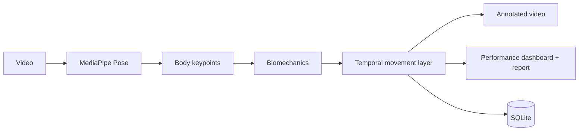

# Football Posture Analysis — Player Motion Lab

[](https://github.com/rsswethaa/football-posture-analysis/actions/workflows/ci.yml)

A product-style sports-analytics computer-vision project that analyses football video or pose sequences, extracts biomechanics, classifies temporal movement states and generates an annotated player-performance report.

## Product capabilities
- real football video upload
- optional MediaPipe Pose + OpenCV integration
- skeleton overlay on analysed footage
- single primary-player pose tracking across frames
- left/right knee angle
- hip angle
- torso lean
- normalised stride proxy
- balance proxy
- horizontal, vertical and ankle motion speed
- temporal movement states: running, sprinting, jumping, kicking, defending and controlled movement
- movement distribution and averaged performance metrics
- downloadable performance report
- SQLite session/model audit trail
- built-in synthetic drill demo that works without CV dependencies
- automated tests, Docker support and CI

## Architecture


## Run the web product
```bash
python -m venv .venv
source .venv/bin/activate  # Windows: .venv\Scripts\activate
pip install -r requirements.txt
python app.py
```
Open `http://127.0.0.1:5000` and use **Run sample drill** immediately.

### Enable real video analysis
```bash
pip install -r requirements-cv.txt
python app.py
```
Then upload MP4, MOV, AVI or MKV football footage.

### Docker
Lightweight dashboard/demo:
```bash
docker build -t player-motion-lab .
docker run -p 5000:5000 player-motion-lab
```
CV-enabled image:
```bash
docker build -f Dockerfile.cv -t player-motion-lab-cv .
docker run -p 5000:5000 player-motion-lab-cv
```

## API
- `POST /api/analyse-keypoints` — testable pose-sequence analysis
- `POST /api/analyse-video` — MediaPipe/OpenCV video analysis
- `GET /api/history` — recent sessions
- `GET /artifacts/<name>` — annotated video/report artifacts
- `GET /health` — service health

## Repository structure
```text
app.py                 product/API layer
src/biomechanics.py    extended pose metrics
src/temporal.py        temporal movement rules
src/pipeline.py        reusable keypoint-sequence pipeline
src/video_pipeline.py  MediaPipe/OpenCV adapter
src/reporting.py       performance summary/report
src/product_storage.py persistence
database/              session/frame/model schema and SQL
templates/, static/     sports dashboard
notebooks/              pose-metric exploration
tests/                  geometry, storage, temporal and API tests
docs/                   architecture, product, API, database, testing, deployment, security, model card and report
```

## What I learned
This project demonstrates pose estimation integration, geometry, temporal analysis, video artifact generation, sports analytics, Flask APIs, persistence, optional-dependency design, Docker and CI.

## Evaluation integrity
The repository does not claim benchmark action-recognition accuracy because no representative labelled football dataset has been evaluated here. The rule-based temporal layer is transparent and can later be replaced by a CNN/LSTM/Transformer trained and evaluated on documented data.

## Safety boundary
The performance report is for educational coaching analytics and is not an injury-risk or medical diagnosis.
