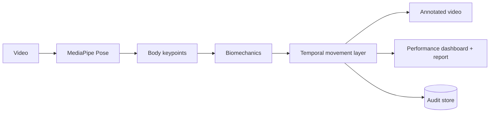

# Football Posture Analysis — Player Motion Lab

**Status: Sports-computer-vision portfolio prototype**

[](https://github.com/rsswethaa/football-posture-analysis/actions/workflows/ci.yml)

**[Live Demo](https://swethaa-football-posture.onrender.com) · [Architecture](docs/ARCHITECTURE.md) · [Model Card](docs/MODEL_CARD.md) · [Security](docs/SECURITY.md)**

Player Motion Lab analyses football video or pose sequences, extracts interpretable biomechanics, classifies temporal movement states and produces an annotated performance report.

## What it does

- accepts real football video when the optional CV dependencies are installed
- supports MediaPipe Pose + OpenCV
- overlays a skeleton on analysed footage
- tracks a primary player across frames
- calculates left/right knee angle, hip angle and torso lean
- derives stride, balance and motion-speed proxies
- classifies temporal states such as running, sprinting, jumping, kicking and defending
- summarises movement distribution and average metrics
- generates downloadable performance reports
- stores session/model audit information
- includes a synthetic drill demo that works without heavyweight CV dependencies
- runs with automated tests, Docker and CI

## Why interpretable biomechanics?

The prototype keeps the first analysis layer geometric and transparent. Joint angles and movement proxies can be inspected directly, which makes it easier to understand failure cases before replacing the temporal rules with a trained sequence model.

## Architecture



## Run the web product

```bash
python -m venv .venv
source .venv/bin/activate  # Windows: .venv\Scripts\activate
pip install -r requirements.txt
python app.py
```

Open `http://127.0.0.1:5000` and use **Run sample drill** immediately.

Enable real video analysis:

```bash
pip install -r requirements-cv.txt
python app.py
```

Then upload MP4, MOV, AVI or MKV football footage.

## Docker

Lightweight dashboard/demo:

```bash
docker build -t player-motion-lab .
docker run -p 5000:5000 player-motion-lab
```

CV-enabled image:

```bash
docker build -f Dockerfile.cv -t player-motion-lab-cv .
docker run -p 5000:5000 player-motion-lab-cv
```

## API

- `POST /api/analyse-keypoints` — pose-sequence analysis
- `POST /api/analyse-video` — MediaPipe/OpenCV video analysis
- `GET /api/history` — recent sessions
- `GET /artifacts/<name>` — annotated video/report artifacts
- `GET /health` — service health

## Engineering trade-off

The default deployment intentionally avoids requiring MediaPipe/OpenCV so CI and the public demo remain lightweight. The real-video path is an optional capability with a separate dependency set and CV Docker image.

## Evaluation integrity

The repository does not claim benchmark action-recognition accuracy because a representative labelled football dataset has not been evaluated here. The temporal layer is transparent and can later be replaced by a CNN/LSTM/Transformer only after a documented train/test protocol exists.

## Safety boundary

The report is educational sports analytics. It is not an injury-risk assessment or medical diagnosis.
