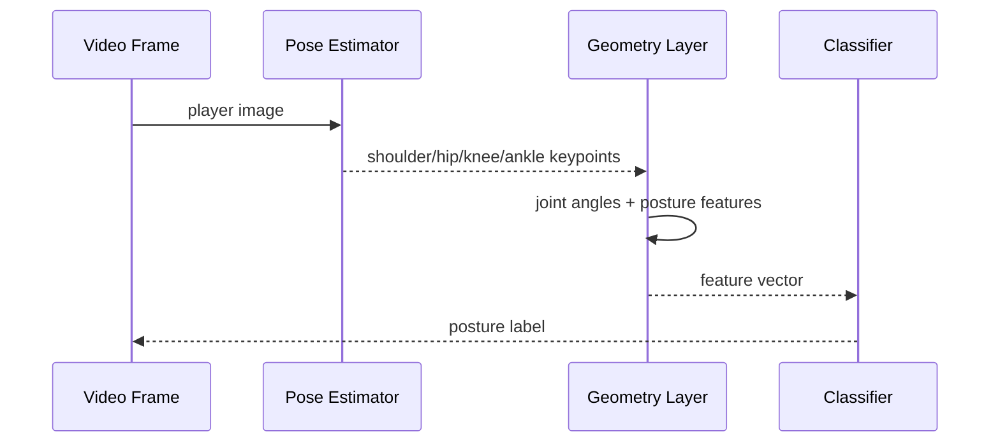

# Architecture

The repository implements the geometry and classification layers directly. A full DL pipeline would use a trained pose-estimation network for keypoint extraction and optionally a temporal network over frame sequences.
