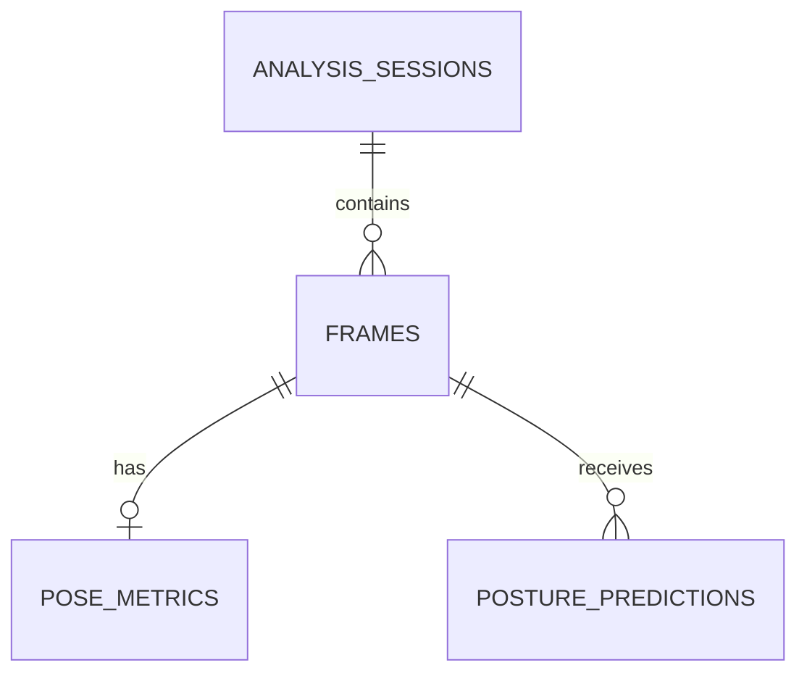

# Database Design

## Tables
- `analysis_sessions`: video/source and pseudonymous player reference.
- `frames`: frame index and optional timestamp.
- `pose_metrics`: derived joint angles, lean and feature confidence.
- `posture_predictions`: posture label, confidence and model version.

This structure separates raw frame identity, engineered geometry and model outputs so analyses remain inspectable and versioned.
