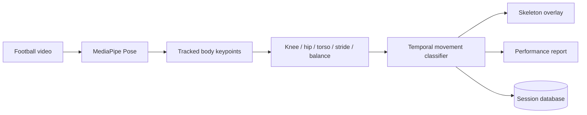

# Product Design — Player Motion Lab

## Business use case
Player Motion Lab turns training video into interpretable movement and posture information for coaching review. It separates pose detection from downstream biomechanics so different pose estimators can be evaluated without rewriting the analytics layer.

## Real-video flow

## Movement states
The lightweight temporal layer demonstrates `RUNNING`, `SPRINTING`, `JUMPING`, `KICKING`, `DEFENDING` and `CONTROLLED`. These are explainable rules for a portfolio product, not benchmarked athlete-action labels.

## Product outputs
- annotated video with pose skeleton and movement label
- frame-level biomechanics samples
- movement distribution
- averaged posture/stride/balance proxies
- coaching-oriented review notes
- downloadable Markdown performance report
- historical session log

## What I learned
- bridging video computer vision with explainable sports metrics
- separating optional heavy pose dependencies from testable geometry
- temporal classification from frame-to-frame motion
- generating visual and report artifacts from model output
- documenting the boundary between coaching analytics and medical claims
